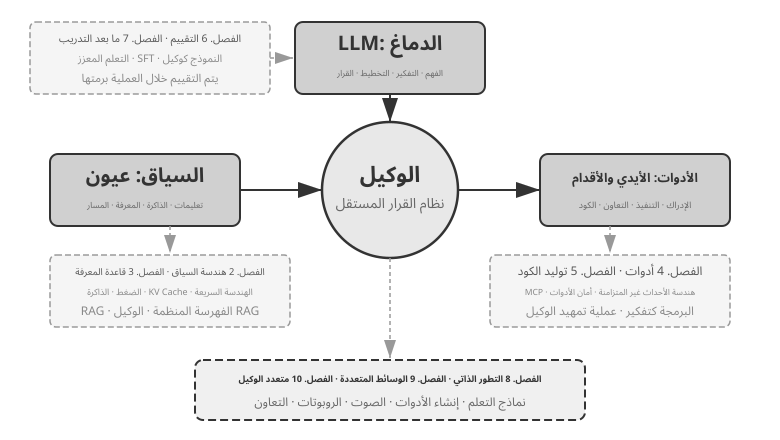
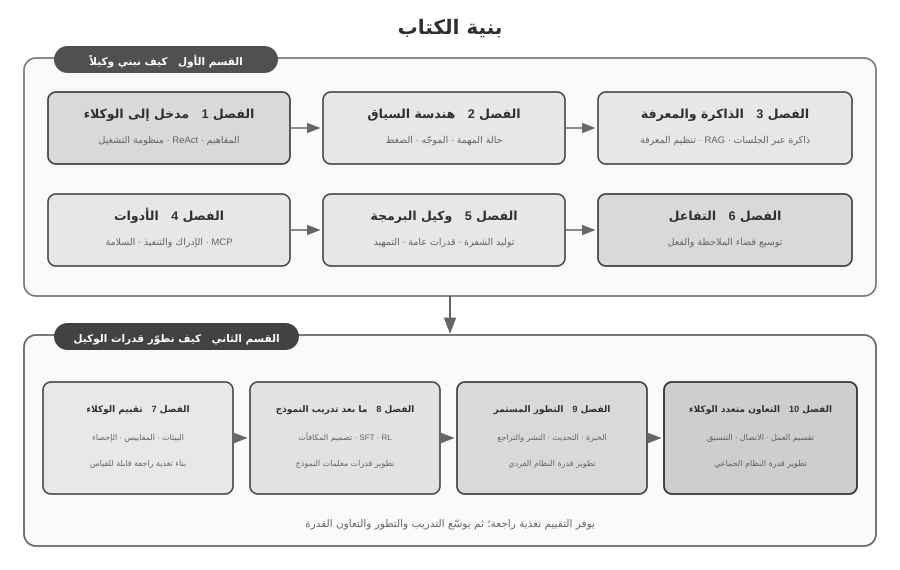

# مقدمة {.unnumbered}

```{=latex}
\markboth{مقدمة}{مقدمة}
```

بين أغسطس وأكتوبر 2025، ألقيت سلسلة من المحاضرات التقنية ضمن «المعسكر التطبيقي لوكلاء الذكاء الاصطناعي» الذي تنظمه دار تورينغ الصينية للنشر التقني. كان الهدف بسيطًا: نقل تصميم وكلاء الذكاء الاصطناعي من منهج يعتمد على الحدس إلى منهج تحكمه المبادئ؛ فلا نكتفي بتشغيل عرض تجريبي (Demo)، بل نفهم *لماذا* صُمّم الوكيل على هذا النحو، وما المفاضلات الكامنة وراء كل قرار معماري. وقد نشأ هذا الكتاب من مواد تلك المحاضرات وتجاربها، بعد تنقيحها وتوسيعها.

أُنجز الكتاب نفسه، من بذرته الأولى إلى مخطوطته النهائية، بأسلوب يمكن تسميته **البرمجة بالهمس** (Whisper Coding)، أي التعاون القائم على الإملاء. وكانت أداة الإملاء هي Pine، وكيلنا الصوتي. عند إعداد كل محاضرة، كنت أملي مخططًا أوليًا، وأطلب من Pine البحث في الموضوع، ثم أدعه يصوغ المسودة الأولى. وبعد المحاضرة، كنت أطلعه على ملاحظات طلاب المعسكر، فندخل في جولات من النقاش والتحسين. ومع كل جولة، نمت ملاحظات المحاضرات حتى صارت الكتاب الذي بين يديك. نادرًا ما كتبت بلوحة المفاتيح أثناء ذلك؛ كنت أفكر بصوت مسموع. فالكلام أسرع من الكتابة بكثير — بنحو أربعة أضعاف في المحادثة العادية — ولذلك كانت دورة «الإملاء، ثم البحث، ثم النقاش، ثم المراجعة» سريعة. ومن هذه الزاوية، لا يتناول هذا الكتاب الوكلاء فحسب، بل هو أيضًا كتاب أسهم وكيل في صنعه.

منذ صدور DeepSeek R1 مطلع عام 2025، تجاوز مجال الذكاء الاصطناعي مرحلة التركيز الخالص على النماذج الأساسية — أي العمود الفقري العام لنماذج اللغة الكبيرة — ودخل صميم النشر الهندسي. ويظهر التقدم على مستوى النموذج في اتجاهين. أولًا، أتاح التعلم المعزز الوكيلي (Agentic RL) للنماذج أن تستبطن القدرة على استدعاء الأدوات ضمن معلماتها، وأن تكتسب قدرات عامة في البرمجة والرياضيات واستخدام الحاسوب. وثانيًا، تسارعت دورات تطوير النماذج: من GPT-5.2 إلى GPT-5.5، ومن Claude Opus 4.5 إلى 4.8، بفاصل لا يتجاوز نصف عام بين كل قفزة وأخرى. أما على مستوى المنتج، فقد أعاد وكلاء عامون مثل Manus وClaude Code وOpenClaw تعريف التفاعل بين الإنسان والحاسوب، ودفعوا بنمط «توليد الشفرة + نظام الملفات» إلى صدارة التصاميم المعمارية.

حين راجعت مبادئ هندسة الوكلاء التي لخّصتها في الدورة قبل نحو عام، لاحظت أمرًا مُرضيًا ومدهشًا في آنٍ معًا: **لم تصبح هذه المبادئ قديمة، بل غدت أكثر رسوخًا.** ومنذ ذلك الحين، انتشرت في صناعة الوكلاء مصطلحات مثل المهارات (Skills)، ومنظومة التشغيل (Harness)، أي الشفرة المحيطة بالنموذج التي تضبط عمله، وهندسة الحلقات (Loop Engineering). غير أن التسلسل الحقيقي كان معكوسًا: لم تخترع شركات مثل Anthropic هذه الممارسات ثم تتبنّاها الصناعة؛ بل كان وكلاء كثيرون يطبقونها بالفعل، ثم استخلصتها Anthropic ومنحتها أسماء بوصفها مبادئ تصميم. تأتي الممارسة أولًا، ثم يأتي الاسم.

وتنبع ثقتي بهذه المبادئ من خبرة فعلية في دفع الوكلاء إلى تنفيذ مهام طويلة ومعقدة وعالية المخاطر في العالم الحقيقي. وبصفتي كبير العلماء في Pine AI، طوّرت مع فريقي وكيل Pine. وهو، بحسب علمي، أول وكيل عام يستطيع التفاعل ذاتيًا مع أشخاص حقيقيين، وإنجاز مهام حساسة ومعقدة وطويلة تتعلق بالأموال إنجازًا موثوقًا: يتصل بشركات الاتصالات نيابة عن المستخدم للتفاوض بشأن الفواتير، ويتابع طلبات الاسترداد والشكاوى مع التجار، ويلغي الاشتراكات، وكل ذلك من دون أن يتدخل إنسان. وقد تمتد المهمة الواحدة إلى عشرات جولات التفاوض، وأي خطأ فيها قد يسبب خسارة مالية حقيقية. هذا الشرط الصارم للموثوقية هو ما صاغ، مبدأً بعد آخر، المبادئ المعمارية التي يعود إليها الكتاب مرارًا. والأمثلة الآتية مأخوذة من هذه الخبرة.

- قبل شيوع مفهوم «المهارة» بوقت طويل، كنا نحمّل الموجّهات ديناميكيًا لمعالجة تضخمها المستمر، وننفذ الأدوات عبر سطر الأوامر لمعالجة تضخم قوائم الأدوات، ونستخدم شريط حالة النظام كي يدرك الوكيل بيئة التنفيذ ووقت المستخدم وحالة المهمة.
- وقبل شيوع مفهوم «منظومة التشغيل» بوقت طويل، كنا نستخدم أساليب شبيهة بما يفعله Claude Code للتعامل مع عدم استقرار استدعاءات الأدوات، والهلوسة، والعمليات الخطرة أو غير المصرح بها، وتجاهل التعليمات.
- وقبل شيوع «هندسة الحلقات» بوقت طويل، كنا نستخدم ما يسميه هذا الكتاب نمط «المقترِح والمراجع» لمنع النموذج من إعلان اكتمال المهمة قبل أوانه.

وليس في ذلك اختراع يخصنا وحدنا؛ فبحسب علمي، توصّلت معظم الشركات الرائدة في النماذج والوكلاء إلى أساليب مشابهة كلٌّ على حدة. لهذا أطلقت معسكر وكلاء الذكاء الاصطناعي في تورينغ في أغسطس 2025، ودرّست مقررًا تطبيقيًا في وكلاء الذكاء الاصطناعي بجامعة الأكاديمية الصينية للعلوم بين عامي 2024 و2026. ولهذا أيضًا اخترت نشر الكتاب مفتوح المصدر بدلًا من إبقائه مغلقًا والاكتفاء بعائداته: أريد لهذه المعرفة أن تصل إلى عدد أكبر من الممارسين.

**تأتي الممارسة أولًا، ثم تأتي التسمية.** وفي هذا الترتيب درس عملي مهم لتطوير وكلاء المؤسسات: **إذا انتظرت حتى يظهر المصطلح الرائج قبل أن تطبق فكرته، فقد تأخرت خطوة بالفعل.** فعندما يشيع المصطلح، تكون الشركات المتقدمة قد أمضت وقتًا في حل المشكلة التي يصفها. فكيف تعرف ما ينبغي فعله قبل ظهور الاسم؟ في رأيي، ثمة أمران أساسيان.

**أولًا، احرص على أن يكون لديك عمل حقيقي يطالب الوكيل بأقصى ما يستطيع، واستخلص منه تغذية راجعة حقيقية باستمرار.** خذ Pine مثلًا: قد تستغرق المهمة الواحدة ساعات بل أسابيع، وتتطلب أخذًا وردًا مع أطراف متعددة؛ ساعات على الهاتف، وصفحات من النماذج المعقدة على الحاسوب، وجولات من البريد الإلكتروني. لا مجال لخطأ في رقم واحد، ويجب أن يحمي كل تفاعل مصالح المستخدم. حين تنغمس في سيناريو بهذه الصعوبة، تدفعك الممارسة تلقائيًا إلى بناء منظومة تشغيل (Harness) تسد الفجوة بين ما يستطيع النموذج فعله منفردًا وما يتطلبه العمل. أما إذا كانت متطلبات المنتج متواضعة ويمكن تلبيتها بمجرد ترقية النموذج، فلن تضطر أصلًا إلى بلورة هذه المبادئ المعمارية.

**ثانيًا، أنشئ آلية للتقييم.** يعود الكتاب إلى هذه الفكرة مرارًا: لا تقدُّمَ بلا تقييم. فالتقييم يبيّن إن كان التغيير تحسينًا حقيقيًا أم نتيجة موفقة عابرة، ويحرر تطوير الوكيل من الاعتماد على الحدس وحده. ما ندعو إليه، في جوهره، هو تطبيق المنهج العلمي في الهندسة وبناء الوكلاء، والتقييم هو أساس هذا المنهج. ويتناول الفصل السابع ذلك بالتفصيل.

ومهما تطورت النماذج الأساسية وتبدلت أشكال المنتجات، تكاد أنظمة الوكلاء الناجحة كلها تتبع الأنماط المعمارية نفسها. وليس ذلك مصادفة: **ينبغي لمبادئ التصميم الجيدة أن تصمد عبر أجيال النماذج**؛ لأنها لا تصف طريقة استخدام نموذج بعينه، بل الأنماط الأساسية لتفاعل الأنظمة الذكية مع العالم.

قال ريتشارد ساتون، الحائز جائزة تورينغ وأبو التعلم المعزز، إن تطور الكون مر بأربع مراحل: الغبار، ثم النجوم، ثم الحياة، ثم الوكلاء (وقد سمّاها في الأصل «الكيانات المصمَّمة»). فالتطور البيولوجي أعمى، تحكمه الطفرات العشوائية والانتقاء الطبيعي؛ ومعظم الكائنات لا تفهم آليات عملها، ولا تستطيع بنفسها أن تصمم كائنات حية أو تعيد تشكيلها. أما الوكلاء فظاهرة جديدة تمامًا في تاريخ تطور الكون: يستطيعون، عبر توليد الشفرة، أن يمهّدوا لأنفسهم ويطوّروا ذواتهم؛ كأن يكتب مبرمجٌ مبرمجًا آخر، ثم يواصل الثاني كتابة غيره. أي إن الوكيل قادر على فهم آلية عمله، وإنشاء وكلاء جدد وفق الهدف، بل وتحسين ذاته. ورسالة هذا الكتاب أن يساعدك على فهم مبادئ هذا الخلق وإتقانها.

تتلخص الفكرة المركزية للكتاب في معادلة واحدة: **الوكيل = نموذج لغوي كبير + سياق + أدوات**. ولا غنى عن أي عنصر منها.



وبصياغة أكثر حدسًا: **دماغ + عينان + يدان وقدمان**. يتولى الدماغ، أي النموذج اللغوي الكبير، التفكير واتخاذ القرار؛ وتحدد العينان، أي السياق، ما يستطيع الوكيل رؤيته من معلومات؛ وتحدد اليدان والقدمان، أي الأدوات، ما يستطيع فعله. (والعينان هنا استعارة تقريبية؛ فالسياق لا يضم معلومات البيئة وسجل المحادثة فحسب، بل تعريفات الأدوات أيضًا. لذلك يشمل ما «يراه» الوكيل الأدوات المتاحة له. والمقصود من الاستعارة هو تثبيت الحدس الأساسي: السياق هو كل ما يستطيع النموذج إدراكه.)

وللقارئ الملمّ بالتعلم المعزز، يمكن مقابلة العناصر الثلاثة بمفاهيمه الصورية: يقابل النموذج اللغوي **السياسة** (Policy)، ويقابل السياق **فضاء الملاحظات** (Observation Space)، وتقابل الأدوات **فضاء الأفعال** (Action Space). إنها ثلاث صيغ للمنظومة نفسها، تختلف فقط في مستوى التجريد.


## هيكل الكتاب {.unnumbered}

يقع هذا الكتاب في عشرة فصول تنتظم على أربعة مستويات (الشكل 0-2). يبني الفصل الأول الإطار الأساسي للوكيل؛ وتناقش الفصول من الثاني إلى السادس كيفية بناء الوكيل، فتبسط السياق والمعرفة والأدوات وتوليد الشفرة والتفاعل تباعًا؛ وتناقش الفصول من السابع إلى التاسع كيفية تقييم الوكيل وتحسينه باستمرار، من أنظمة القياس وما بعد تدريب النموذج وصولًا إلى التطوّر المستمر المدفوع بخبرة التشغيل؛ ثم يوسّع الفصل العاشر الأفق إلى التعاون متعدد الوكلاء.



- **الفصل الأول (أساسيات الوكلاء)** ينطلق من منتجات حقيقية ليكوّن تصورًا أوليًا واضحًا عن الوكلاء، ثم يتعمق في الصيغة الأساسية: النموذج اللغوي الكبير + السياق + الأدوات. ويعرض الصيغة نفسها بصورتها الحدسية: الدماغ + العينان + اليدان والقدمان، ثم بصيغتها الأكاديمية: السياسة + فضاء الملاحظات + فضاء الأفعال. وتوضح التجارب حلقة ReAct التكرارية: «التفكير → الفعل → الملاحظة»، مع التمييز بين التكيف السياقي داخل المهمة الواحدة، وتحديث المكونات الخارجية الدائمة (كالمعرفة والمهارات والشفرة) من مهمة إلى أخرى، وتحديث المعلمات في دورات التدريب. ويختتم الفصل بأنماط تصميم التنسيق (Orchestration)، من مسارات العمل المحددة سلفًا إلى الوكلاء المستقلين، ليضع إطارًا مفاهيميًا موحدًا للفصول التالية.
- **الفصل الثاني (هندسة السياق)** هو أهم فصول الكتاب؛ إذ يتناول «عيني» الوكيل بصورة منهجية. يبدأ ببنية رسائل API والحلقة الأساسية للوكيل، ويؤسس لفكرة أن السياق قائمة من الرسائل، ثم يشرح المبادئ الأساسية لذاكرة التخزين المؤقت KV Cache، وهي الآلية التي تتيح إعادة استخدام نتائج الحساب السابقة أثناء استدلال النموذج. بعد ذلك يتناول هندسة الموجّهات، بما فيها تنظيم الموجّه على هيئة إجراءات متسلسلة بدلًا من تكديس القواعد، وأوصاف الأدوات، وتحويل قواعد العمل إلى تعليمات قابلة للتنفيذ؛ ثم يعرض هجمات حقن الموجّهات وسبل صدها، والتحميل عند الطلب لمهارات الوكيل، وشريط حالة الوكيل، واستراتيجيات ضغط السياق. وتُعرَّف هذه المصطلحات تعريفًا كاملًا عند ورودها للمرة الأولى في متن الفصل.
- **الفصل الثالث (ذاكرة المستخدم وقواعد المعرفة)** يوسع إدارة السياق إلى منظومة معرفية دائمة تتجاوز حدود الجلسة الواحدة. وبذلك لا يكتفي الوكيل بتذكر المحادثة الحالية، بل يراكم المعرفة ويسترجعها عبر محادثات متعددة. ويعرض الفصل أربع استراتيجيات متدرجة لذاكرة المستخدم، والمنظومة التقنية الكاملة لـ RAG (التوليد المعزز بالاسترجاع، أي استرجاع المستندات ذات الصلة قبل أن يولّد النموذج إجابته)، بما فيها طرائق البحث النصي المختلفة وتحسين الترتيب، واستخراج المعلومات متعددة الوسائط، وأساليب متقدمة لتنظيم المعرفة، وRAG القائم على الوكلاء الذي يقرر فيه الوكيل بنفسه متى يسترجع المعلومات وما الذي يسترجعه.
- **الفصل الرابع (الأدوات)** يبحث في الجسر الذي يصل الوكيل بالعالم الخارجي. فالأدوات هي «يداه وقدماه»، وبها يبحث في الويب، ويستدعي واجهات API، ويتعامل مع قواعد البيانات وغيرها. ويقدم الفصل معيار MCP للتشغيل البيني ومبادئ تصميم خمس فئات من الأدوات: الإدراك والتنفيذ والتعاون وإطلاق الأحداث والتواصل مع المستخدم؛ كما يعرض ثلاثة مسارات للإدراك متعدد الوسائط: المعالجة الأصلية متعددة الوسائط، والتحويل إلى نص، والتحليل متعدد الوسائط القائم على الأدوات، مع عناية خاصة بآليات أمان أدوات التنفيذ. أما إطلاق الأحداث والتواصل مع المستخدم وبيئة التشغيل غير المتزامنة فتُعرض في الفصل السادس.
- **الفصل الخامس (وكيل البرمجة وتوليد الشفرة)** يبين أن وكيل البرمجة ونظام الملفات يشكلان معًا الأساس التقني الجوهري لكل وكيل عام الغرض. ويتخذ من بنية OpenClaw خيطًا ناظمًا لتحليل سير عمل وكيل البرمجة وتقنيات تنفيذه، كما يوضح أن قيمة توليد الشفرة تتجاوز البرمجة نفسها، فتشمل دعم التفكير، وبناء قواعد المعرفة، وإنشاء أدوات جديدة ديناميكيًا، والتمهيد الذاتي للوكلاء (Bootstrapping)، أي أن يستخدم الوكيل الشفرة لإصلاح وكلاء قائمين وإنشاء وكلاء جدد.
- **الفصل السادس (التفاعل: توسيع فضاء الملاحظات وفضاء الأفعال)** يتخلى عن افتراض «تبادل الأدوار في الحديث» الذي بُنيت عليه الفصول الخمسة السابقة، ويبسط تفاعل الوكيل مع العالم على محورَي **الوسيط** و**التوقيت**: فاللاتزامن والتوجّه بالأحداث يتيحان للعالم أن يوقظ الوكيل (أدوات إطلاق الأحداث، وأدوات التواصل مع المستخدم، والهوية الافتراضية وبيئات التنفيذ المعزولة)؛ والصوت يدفع التفاعل إلى نطاق أجزاء الثانية (من خطوط المعالجة المتتالية إلى نماذج طرف-إلى-طرف الشاملة لجميع الوسائط ونماذج الازدواج الكامل)؛ واستخدام الحاسوب (Computer Use) يمكّن الوكيل من تشغيل الواجهات الرسومية كما يفعل الإنسان؛ أما المناولة الروبوتية فتمدّ الفعل إلى العالم المادي (التحكم بنماذج VLA، والنقل من المحاكاة إلى الواقع Sim2Real). وتتشارك السيناريوهات الأربعة مجموعة العناصر الأولية نفسها: الإيقاظ، والنقطة الآمنة (أي اللحظة التي يمكن فيها مقاطعة الوكيل دون إفساد عمله)، والإلغاء، والاستباق (Preemption)، والفصل بين التفكير السريع والتفكير البطيء.
- **الفصل السابع (تقييم الوكلاء)** يضع منهجية علمية للتقييم. ويتناول بيئات التقييم، أي نموذجيها الأساسيين: استدعاء الأدوات والتفاعل بين الإنسان والحاسوب، إضافة إلى بيئات المحاكاة التي تُناقش على حدة في نهاية الفصل، ومبادئ تصميم مجموعات البيانات، والتقييم الآلي بأسلوب LLM-as-a-Judge، واختيار النموذج على أساس نتائج التقييم، والحلقة المغلقة التي تحول نتائج التقييم إلى تحسينات عملية في النظام.
- **الفصل الثامن (مرحلة ما بعد تدريب النموذج)** يتعمق في تقنيتين: الضبط الدقيق تحت الإشراف (SFT)، الذي يعلم النموذج اتباع أمثلة موسومة، والتعلم المعزز (RL)، الذي يتيح له التحسن بالتجربة والخطأ وإشارات المكافأة. ويتمحور الفصل حول فكرتين: «SFT يحفظ، وRL يعمم» و«البيانات والبيئة أهم من الخوارزمية». كما يغطي الصورة الكاملة لمراحل التدريب المسبق وSFT وRL، والنظرية الكلاسيكية للتعلم المعزز، وتصميم إشارات المكافأة — من المكافآت الثنائية ومكافآت العملية إلى عقوبات المسار المتحقَّق منه التي «تكافئ النتيجة وتقيّد العملية» — والخوارزميات أحادية الجولة ومتعددة الجولات، وموضوعات متقدمة مثل تحسين كفاءة العينات.
- **الفصل التاسع (التطور المستمر للوكيل)** يدرس كيفية تحويل الخبرة التشغيلية إلى قدرات في الإصدار التالي. يبدأ ببناء إشارات التعلم على ثلاث طبقات: النتائج الفعلية في البيئة، وقواعد الإجراءات التي يجب احترامها، ومعايير تقييم الجودة (Rubric) التي يطبقها نموذج لغوي. ثم يقارن بين أربعة مواضع يمكن أن تُحفَظ فيها الخبرة المكتسبة: وثائق المعرفة، والموجّهات والمهارات، والبرامج ومنظومة التشغيل (Harness)، ومعلمات النموذج. ويختتم بالتحقق من الإصدار المرشح قبل اعتماده، والإطلاق التجريبي المحدود (Canary)، والتراجع إلى الإصدار السابق، وترسيخ الخبرة على المدى الطويل.
- **الفصل العاشر (التعاون متعدد الوكلاء)** يناقش الشكل الأرقى لأنظمة وكلاء الذكاء الاصطناعي: كيف يقسّم عدة وكلاء العمل فيما بينهم ويتعاونون. ويقدم إطارًا منهجيًا لتصنيف أنماط التعاون وفق محورين: السياق المشترك أو المستقل، والبنية النظيرة أو القائمة على مدير أو اللامركزية. ثم يستخدم وكلاء الترجمة، ووكلاء يجمعون بين الهاتف والحاسوب، لشرح التصميم التعاوني، ويناقش الاتجاهات الناشئة في مجتمعات الوكلاء واقتصاداتهم.

## كيفية قراءة هذا الكتاب {.unnumbered}

فصول الكتاب مستقلة نسبيًا، ولذلك يمكنك اختيار مسار القراءة الأنسب لاحتياجاتك:

- **إن كنت مطوّر وكلاء**، فيُستحسن أن تقرأ الفصول من الأول إلى التاسع بالترتيب: تعطيك الفصول الستة الأولى طرائق البناء، ويؤسّس الفصل السابع قاعدة التقييم، ويشرح الفصل الثامن كيفية تدريب النموذج، ثم يجمع الفصل التاسع المعلمات وسائر مواضع حفظ الخبرة في حلقة تطوّر مستمر مكتملة. أما الفصل العاشر فيمكن قراءته انتقائيًّا بحسب حاجتك إلى التعاون متعدد الوكلاء.
- **إذا كان وقتك محدودًا**، فامنح الأولوية للفصل الأول لاستيعاب الصورة العامة، وللفصل الثاني لهندسة السياق — وهي المهارة الأكثر أهمية. تُعد المبادئ الأساسية لذاكرة التخزين المؤقت (KV Cache) في الفصل الثاني تقنية إلى حد ما؛ لذا يمكنك في القراءة الأولى تخطي التفاصيل الآلية والاحتفاظ فقط بالاستنتاجات الأساسية الثلاثة المذكورة في البداية، دون أن يؤثر ذلك في فهمك للموضوعات اللاحقة.
- **إذا كان تركيزك منصبًا على تدريب النماذج**، فانتقل مباشرة إلى الفصل الثامن (مرحلة ما بعد تدريب النموذج). ولأن طرق التقييم الواردة في الفصل السابع تُعد شرطًا أساسيًا للتدريب، يُستحسن قراءتهما معًا بعد استكمال الفصلين الأول والثاني.

يتضمن كل فصل عددًا كبيرًا من **التجارب** و**أسئلة التأمل**، مرقمة بصيغة «التجربة X-Y»، حيث X رقم الفصل وY ترتيب التجربة فيه. وتشير النجوم في عناوين التجارب وأسئلة التأمل إلى مستوى الصعوبة: ★ للمستوى التمهيدي المناسب لجميع القراء، و★★ للمستوى المتوسط الذي يتطلب قدرًا من الخبرة الهندسية، و★★★ للتحديات المتقدمة التي تتناول عادة مسائل مفتوحة أو تصميمات نظم معقدة. وتأتي معظم التجارب مع شفرة كاملة قابلة للتشغيل في المستودع المفتوح المصدر المصاحب:

> **مستودع الشفرة المصاحب**: [https://github.com/bojieli/ai-agent-book](https://github.com/bojieli/ai-agent-book)

يمكنك الحصول على جميع الشفرات المصاحبة باستخدام Git:

```bash
git clone https://github.com/bojieli/ai-agent-book.git
cd ai-agent-book
```

إذا كنت لا تستخدم Git، فيمكنك أيضًا اختيار **Code → Download ZIP** من صفحة المستودع. تُنظَّم شفرات التجارب حسب الفصول في المجلدات من `chapter1/` إلى `chapter10/`. للعثور على «التجربة X-Y»، افتح الملف المقابل `chapterX/README.ar.md`، واستخدم رقم التجربة لتحديد مجلد المشروع، ثم اتبع ملف README الخاص بالمشروع لتثبيت الاعتماديات وتشغيله. تعتمد بعض التجارب الموسومة بأنها أدلة لإعادة الإنتاج على مستودعات خارجية؛ وتوضح ملفات README الخاصة بها كيفية الحصول عليها أيضًا.

وأوصي بشدة بتنفيذ هذه التجارب بنفسك؛ فبناء وكلاء الذكاء الاصطناعي مجال عملي بامتياز، وكثير من **الحدس التصميمي** لا يتكوّن إلا أثناء التجربة وتصحيح الأخطاء.

**ملاحظة حول المصطلحات**: يميز هذا الكتاب بين مفهومين يختلطان كثيرًا في الاستعمال. **التفكير** (Reasoning) هو معالجة النموذج للمسألة خطوةً خطوة، كما في نماذج التفكير وسلسلة الأفكار ورموز التفكير. أما **الاستدلال** (Inference) فهو تنفيذ المرور الأمامي للنموذج عند الاستخدام، كما في تكلفة الاستدلال ومنظومته والتوسع في زمن الاستدلال (Inference-time Scaling). وتفصل الطبعة الصينية بينهما بالمصطلحين 思考 (للتفكير) و推理 (للاستدلال) حرصًا على عدم الخلط بين الفكرتين، وتلتزم الترجمة العربية بهذا الفصل الدلالي؛ وتعود دراسة حالة الترجمة في الفصل العاشر إلى هذا الاصطلاح. أما سائر المصطلحات الأساسية فتُعرَّف عند ورودها للمرة الأولى.

## المتطلبات الأساسية {.unnumbered}

يستهدف هذا الكتاب القراء ذوي الخلفية التقنية، لكنه لا يتطلب خبرة عميقة في مجال بعينه. وتُصنف المتطلبات الأساسية أدناه ضمن مستويين: «أساسي» و«موصى به»، لمساعدتك في تقييم مدى استعدادك.

**المستوى الأساسي: متطلبات قراءة الكتاب كاملًا**

- **برمجة بايثون (Python)**: تعتمد جميع تجارب الكتاب تقريبًا على Python. يُفترض الاطلاع على البنية الأساسية للغة، وهياكل البيانات الشائعة، وإدارة الحزم (`pip`). لا تُشترط الاحترافية، بل القدرة على قراءة شفرات Python متوسطة التعقيد وتعديلها.
- **الخبرة الأساسية بالنماذج اللغوية الكبيرة (LLM)**: تجربة سابقة في التعامل مع ChatGPT أو Claude أو منتجات مماثلة، وفهم نمط التفاعل الأساسي «الموجّه → استجابة النموذج» (`Prompt → Model Response`).
- **أداة برمجة مدعومة بالذكاء الاصطناعي**: ثبّت أداة واحدة على الأقل، مثل Claude Code أو Codex أو Cursor أو TRAE، واعتد على استخدامها. فمن جهة، ستسرّع هذه الأدوات التجارب كثيرًا، لأنها تتطلب قدرًا كبيرًا من كتابة الشفرة وتصحيح أخطائها. ومن جهة أخرى، هي نفسها وكلاء برمجة ناضجون: وباستخدامها ستعايش مباشرة الآليات الجوهرية التي يعود إليها الكتاب مرارًا، كحلقة ReAct واستدعاء الأدوات وإدارة السياق. وهذه التجربة المباشرة لا تقدّر بثمن لفهم مبادئ تصميم الوكلاء.
- **معرفة عامة بهندسة البرمجيات**: إلمام بمفاهيم أساسية مثل التعامل مع سطر الأوامر، ونظام ضبط الإصدارات Git، وتنسيق بيانات JSON، وواجهات REST API. فهذه هي الأساس لتشغيل التجارب وفهم آلية استدعاء الوكيل للأدوات.

**المستوى الموصى به: لتعزيز الاستيعاب في فصول محددة**

- **أساسيات التعلم الآلي** (الفصل 8): فهم المفاهيم الأساسية مثل التدريب مقابل الاستدلال، ودوال الخسارة، والانحدار التدرّجي (Gradient Descent)، وفرط التخصيص (Overfitting)، مما يساعدك على فهم مرحلة ما بعد التدريب.
- **الرياضيات الأساسية** (الفصول 2-3، 8): فهم بديهي للجبر الخطي (كأن تعرف أن المتجهات تمثل الاتجاه والمقدار، وأن المصفوفات تنفذ عمليات دفعية) يساعدك على فهم التضمينات وآليات الانتباه، ومعرفة أساسية بالاحتمالات والإحصاء تعينك على فهم مقاييس التقييم والمكافآت المتوقعة في التعلم المعزز. ولا تتضمن رياضيات الكتاب اشتقاقات معقدة، بل تركز على الشرح البديهي.
- **أساسيات تطوير الويب** (الفصل 6): فهم مفاهيم HTTP وWebSocket وبنية فصل الواجهة الأمامية عن الخلفية، لفهم بنية الوكيل غير المتزامن الموجه بالأحداث وتجارب الاتصال الفوري في الوكلاء الصوتيين.
- **الفهم الأساسي لبنية المحولات (Transformer)** (الفصول 2، 8): بنية Transformer هي العمود الفقري لجميع النماذج اللغوية الكبيرة الحالية تقريبًا. ومن يرغب في بناء معرفته الأساسية بالنماذج الكبيرة بصورة منهجية قد يجد فائدة في كتاب *Illustrating Large Models* (图解大模型، الصادر بالصينية عن دار تورينغ)، الذي يشرح بالرسوم البديهية مفاهيم جوهرية مثل بنية Transformer والتدريب المسبق والضبط الدقيق، فيكمّل منظور هذا الكتاب في هندسة الوكلاء.

وإن كانت تنقصك بعض هذه المتطلبات، فلا تقلق. فالقيمة الأساسية لهذا الكتاب تكمن في **مبادئ التصميم المعماري والمنهجية الهندسية**، لا في خوارزمية أو تقنية بعينها. وباستثناء الفصل الثامن عن مرحلة ما بعد التدريب، لا يتطلب الكتاب إلا قدرًا يسيرًا من الرياضيات والتعلم الآلي، ويصلح تمامًا نقطةً للانطلاق.

ما زالت تقنيات الوكلاء تتطور بسرعة، لكن **مبادئ التصميم المعماري الجيدة قادرة على الصمود عبر الزمن**. فإذا أتقنت «لماذا» وراء كل تصميم، حافظت على وضوح حكمك مهما تلاحقت موجات التقنية. وآمل أن يكون هذا الكتاب دليلًا موثوقًا لك وأنت تبني وكلاء الذكاء الاصطناعي.

## شكر وتقدير {.unnumbered}

أتقدم بالشكر إلى المحررَين Meng Ge وLiu Meiying في دار تورينغ على جهدهما الدؤوب في التحرير وتنظيم «المعسكر التطبيقي لوكلاء الذكاء الاصطناعي» في تورينغ، وإلى البروفيسور Liu Junming على تقديمه مقررًا تطبيقيًا في وكلاء الذكاء الاصطناعي في جامعة الأكاديمية الصينية للعلوم. وشكر خاص لجميع طلاب «المعسكر التطبيقي لوكلاء الذكاء الاصطناعي» في تورينغ، وطلاب مقرر وكلاء الذكاء الاصطناعي في جامعة الأكاديمية الصينية للعلوم؛ فقد أتاح لي تدريس هذين المقررين قدرًا كبيرًا من ملاحظاتكم ونصائحكم القيّمة، وعمّق فهمي لهذه المفاهيم.

أشكر جميع زملائي في Pine AI. فلولا منتج متميز مثل Pine AI، والتحديات الكثيرة التي جاء بها، لما تمكنت من التعمق في مجال الوكلاء، فهمًا وممارسةً؛ وقد أسهم زملائي، عبر نقاشات متواصلة، بثروة من الأفكار القيّمة.

وأشكر كذلك أصدقاء كثيرين في مجال الذكاء الاصطناعي، يتعذر ذكرهم جميعًا هنا. فقد منحوني، عبر نقاشات متتابعة، ملاحظات صريحة على آرائي، وصححوا كثيرًا من أحكامي الخاطئة، وعمّقوا فهمي للنماذج والوكلاء.

وفوق ذلك كله، أشكر عائلتي، وخاصة زوجتي منغ جياينغ (Meng Jiaying)؛ فقد دعمتني طوال مدة تأليف هذا الكتاب، وقدّمت لي كثيرًا من الاقتراحات القيّمة.
