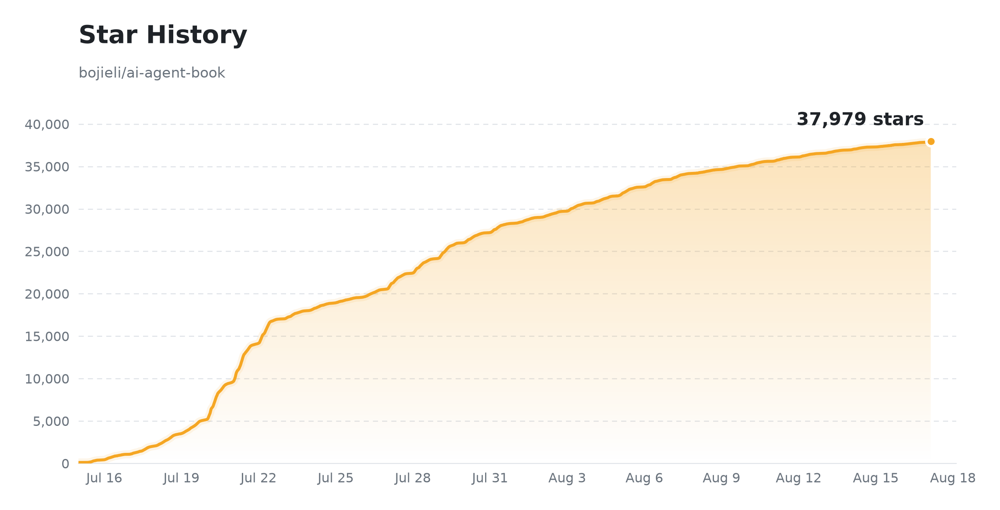

# AI 에이전트를 깊이 이해하기: 설계 원리와 엔지니어링 실전

[](#-전자책) [](https://bojieli.github.io/ai-agent-book/astro/ko/) [](https://github.com/bojieli/ai-agent-book) [](../../LICENSE) [](#-전자책)
[](https://github.com/trending)

**[中文](../../README.md) · [English](../en/README.md) · [Español](../es/README.md) · [Bahasa Indonesia](../id/README.md) · [العربية](../ar/README.md) · [繁體中文（台灣）](../zh-TW/README.md) · [Русский](../ru/README.md) · [Tiếng Việt](../vi/README.md) · [தமிழ்](../ta/README.md) · [日本語](../ja/README.md) · [Türkçe](../tr/README.md) · 한국어 ← 현재 · [Magyar](../hu/README.md) · [עברית](../../README.he.md) · [Português (Brasil)](../../README.ptbr.md)**

> 📥 **[PDF / EPUB 다운로드](#-전자책)**(권장) — PDF와 EPUB 판본에서 가장 좋은 읽기 경험을 제공합니다. [온라인 판본](https://bojieli.github.io/ai-agent-book/astro/ko/)에서는 언어 전환, 접을 수 있는 장별 탐색, 강조 표시와 메모을 이용할 수 있습니다.

**에이전트 = LLM + 컨텍스트 + 도구** — 이 책은 이 핵심 공식을 중심으로 10개 장에 걸쳐 AI 에이전트의 원리부터 엔지니어링 실전까지 설명합니다. 본문과 그림, **94개의 연계 실습**을 모두 오픈 소스로 공개합니다.

> 📚 **자매편 『AI 인프라를 깊이 이해하기: 정량 분석과 시스템 설계』가 오픈 소스로 공개되었습니다** — [github.com/bojieli/ai-infra-book](https://github.com/bojieli/ai-infra-book)
>
> 모델 기반 애플리케이션을 제대로 개발하려면 그것이 돌아가는 인프라도 이해해야 합니다. 자매편은 모델 학습과 추론을 떠받치는 AI 인프라를 다룹니다. 파라미터와 컨텍스트 상태가 어디에 저장되고, 연산이 어떻게 수행되며, 여러 가속기가 어떻게 협력하는지를 설명합니다.

> 📢 **1.4 대비 2.0 버전의 변경 사항:** 2.0 버전은 기존 4장의 “비동기 상호작용” 부분과 기존 9장의 “멀티모달 에이전트” 내용을 합쳐, 새로운 6장 “상호작용: 관찰 공간과 행동 공간의 확장”으로 재구성했습니다. 기존 6장 “에이전트 평가”, 7장 “모델 사후 학습”, 8장 “에이전트의 지속적 진화”는 각각 한 장씩 뒤로 이동하여 현재 7장, 8장, 9장이 되었습니다.
>
> 이전 PDF를 읽고 계시다면 [최신 PDF를 다운로드](https://github.com/bojieli/ai-agent-book/releases/download/latest/AI-Agents-in-Depth-ko.pdf)하시기를 권장합니다. 신판에는 많은 내용 수정과 조정도 포함되어 있으므로 최신 버전을 이용해 주세요.

| 📚 기초부터 프로덕션까지 **10개 장** | 📂 **94개** 연계 실습(로컬 프로젝트와 외부 재현 트랙 포함) | 🌐 **15개 언어**: 중 / 영 / 스페인 / 인도네시아 / 아랍 / 번체 중국어(대만) / 러 / 타밀 / 베트남 / 일 / 터키 / 한 / 헝가리 / 히브리 / 포르투갈어(브라질) |
| :---: | :---: | :---: |

## 📖 전자책

> 📥 **다운로드**(전체 본문, 무료·오픈 소스). 아래 링크는 항상 `main` 브랜치의 최신 빌드를 가리킵니다. 고정 버전은 [Releases](https://github.com/bojieli/ai-agent-book/releases)에서 확인할 수 있습니다.
> - **한국어**(커뮤니티 번역, [@JeongJaeSoon](https://github.com/JeongJaeSoon)): [PDF](https://github.com/bojieli/ai-agent-book/releases/download/latest/AI-Agents-in-Depth-ko.pdf) · [EPUB](https://github.com/bojieli/ai-agent-book/releases/download/latest/AI-Agents-in-Depth-ko.epub)
> - **중국어 원문**: [PDF](https://github.com/bojieli/ai-agent-book/releases/download/latest/AI-Agents-in-Depth-zh-CN.pdf) · [EPUB](https://github.com/bojieli/ai-agent-book/releases/download/latest/AI-Agents-in-Depth-zh-CN.epub)
> - **영어**([@nsdevaraj](https://github.com/nsdevaraj), [@whanyu1212](https://github.com/whanyu1212)): [PDF](https://github.com/bojieli/ai-agent-book/releases/download/latest/AI-Agents-in-Depth-en.pdf) · [EPUB](https://github.com/bojieli/ai-agent-book/releases/download/latest/AI-Agents-in-Depth-en.epub)
> - **스페인어**(커뮤니티 번역, [@santhreal](https://github.com/santhreal)): [PDF](https://github.com/bojieli/ai-agent-book/releases/download/latest/AI-Agents-in-Depth-es.pdf) · [EPUB](https://github.com/bojieli/ai-agent-book/releases/download/latest/AI-Agents-in-Depth-es.epub)
> - **번체 중국어(대만)**([@tigercosmos](https://github.com/tigercosmos)): [PDF](https://github.com/bojieli/ai-agent-book/releases/download/latest/AI-Agents-in-Depth-zh-TW.pdf) · [EPUB](https://github.com/bojieli/ai-agent-book/releases/download/latest/AI-Agents-in-Depth-zh-TW.epub)
> - **러시아어**([@ui99ru](https://github.com/ui99ru)): [PDF](https://github.com/bojieli/ai-agent-book/releases/download/latest/AI-Agents-in-Depth-ru.pdf) · [EPUB](https://github.com/bojieli/ai-agent-book/releases/download/latest/AI-Agents-in-Depth-ru.epub)
> - **타밀어**([@nsdevaraj](https://github.com/nsdevaraj)): [PDF](https://github.com/bojieli/ai-agent-book/releases/download/latest/AI-Agents-in-Depth-ta.pdf) · [EPUB](https://github.com/bojieli/ai-agent-book/releases/download/latest/AI-Agents-in-Depth-ta.epub)
> - **베트남어**([@toanalien](https://github.com/toanalien)): [PDF](https://github.com/bojieli/ai-agent-book/releases/download/latest/AI-Agents-in-Depth-vi.pdf) · [EPUB](https://github.com/bojieli/ai-agent-book/releases/download/latest/AI-Agents-in-Depth-vi.epub)
> - **일본어**([@eltociear](https://github.com/eltociear)): [PDF](https://github.com/bojieli/ai-agent-book/releases/download/latest/AI-Agents-in-Depth-ja.pdf) · [EPUB](https://github.com/bojieli/ai-agent-book/releases/download/latest/AI-Agents-in-Depth-ja.epub)
> - **아랍어**([@TheSyBuilder](https://github.com/TheSyBuilder)): [PDF](https://github.com/bojieli/ai-agent-book/releases/download/latest/AI-Agents-in-Depth-ar.pdf) · [EPUB](https://github.com/bojieli/ai-agent-book/releases/download/latest/AI-Agents-in-Depth-ar.epub)
> - **터키어**([@memisemre](https://github.com/memisemre)): [PDF](https://github.com/bojieli/ai-agent-book/releases/download/latest/AI-Agents-in-Depth-tr.pdf) · [EPUB](https://github.com/bojieli/ai-agent-book/releases/download/latest/AI-Agents-in-Depth-tr.epub)
>
> 🌐 [온라인으로도 읽을 수 있습니다](https://bojieli.github.io/ai-agent-book/astro/ko/). `main` 브랜치가 갱신될 때마다 사이트가 자동으로 다시 빌드됩니다.

중국어 원문은 [`book/`](../../book/)에 있으며, 한국어판은 [`book-ko/`](../../book-ko/)에 있습니다. 다른 언어판은 각 언어 디렉터리에 있는 커뮤니티 번역으로, 중국어 원문보다 갱신이 늦을 수 있습니다.

<details>
<summary><b>🔧 PDF / EPUB를 직접 빌드하려면?</b> (PDF는 pandoc / xelatex / ElegantBook 필요)</summary>

- **EPUB**: 공통 빌더를 사용합니다. 자세한 내용은 [EPUB 빌드 안내](../../EPUB.md)를 참고하세요
- **본문 소스**: `book-ko/introduction.ko.md`, `book-ko/chapter1.ko.md` \~ `book-ko/chapter10.ko.md`, `book-ko/afterword.ko.md`
- **빌드**: pandoc, xelatex, ElegantBook 문서 클래스와 Noto CJK KR 글꼴을 설치한 뒤 다음을 실행합니다.

  ```bash
  cd book-ko && bash build_pdf.sh
  ```

  그림은 `book-ko/images/`의 SVG 파일을 사용합니다. 조판 설정은 `book-ko/preamble.tex`와 `book-ko/*.lua`에서 확인할 수 있습니다.

</details>

## 📑 한눈에 보는 구성

| 장 | 주제 | 핵심 내용 | 본문 | 코드 |
| :--: | --- | --- | :--: | :--: |
| 1 | 🚀 **AI 에이전트 기초** | **에이전트 = LLM + 컨텍스트 + 도구**. 경쟁력의 핵심은 하네스 엔지니어링 | [읽기](../../book-ko/chapter1.ko.md) | [4](../../chapter1/README.ko.md) |
| 2 | 🎯 **컨텍스트 엔지니어링** | KV Cache, 프롬프트 엔지니어링, Agent Skills, 컨텍스트 압축 | [읽기](../../book-ko/chapter2.ko.md) | [8](../../chapter2/README.ko.md) |
| 3 | 📚 **사용자 메모리와 지식 베이스** | 세션 간 사용자 메모리, RAG, 구조화 색인, 지식 그래프 | [읽기](../../book-ko/chapter3.ko.md) | [12](../../chapter3/README.ko.md) |
| 4 | 🛠️ **도구** | MCP, 인식·실행·협업 도구, 이벤트 기반 비동기 에이전트, 능동적 도구 탐색 | [읽기](../../book-ko/chapter4.ko.md) | [8](../../chapter4/README.ko.md) |
| 5 | 💻 **코딩 에이전트와 코드 생성** | 코드는 새 도구를 만들 수 있는 도구. 프로덕션급 코딩 에이전트의 전체 구조 | [읽기](../../book-ko/chapter5.ko.md) | [13](../../chapter5/README.ko.md) |
| 6 | 🎙️ **상호작용: 관찰 공간과 행동 공간의 확장** | 모달리티와 시간 차원에서 에이전트의 관찰·행동 공간을 확장: 비동기·이벤트 기반 시스템, 음성, Computer Use, 로보틱스 | [읽기](../../book-ko/chapter6.ko.md) | [14](../../chapter6/README.ko.md) |
| 7 | 🎯 **에이전트 평가** | 성능을 비교 가능한 신호로 전환: 평가 환경, 지표, 통계적 유의성, 평가 기반 선택 | [읽기](../../book-ko/chapter7.ko.md) | [13](../../chapter7/README.ko.md) |
| 8 | 🧠 **모델 사후 학습** | 사전 학습·SFT·RL의 세 단계: SFT와 RL의 선택, 도구 호출 내재화, 샘플 효율성 | [읽기](../../book-ko/chapter8.ko.md) | [19](../../chapter8/README.ko.md) |
| 9 | 🔄 **에이전트의 지속적 진화** | 실행 궤적에서 학습 신호를 얻고 지식·지침·프로그램·파라미터를 갱신 | [읽기](../../book-ko/chapter9.ko.md) | [9](../../chapter9/README.ko.md) |
| 10 | 🤝 **멀티 에이전트 협업** | 협업 구조, 컨텍스트 공유와 격리, 에이전트 사회 | [읽기](../../book-ko/chapter10.ko.md) | [8](../../chapter10/README.ko.md) |

> 💡 **읽기**는 GitHub에서 장 본문을 여는 링크이며, **N**은 해당 장의 연계 프로젝트 수입니다. 프로젝트 유형(✅ 독립 실행 / 📖 재현 가이드 / 🚧 진행 중)은 각 장의 README에 설명되어 있습니다.
>
> 📚 효율적인 학습 순서는 **[학습 가이드](LEARNING.md)**에서 확인하세요.

## 🔑 API 키

실습을 원활하게 진행하려면 몇 가지 플랫폼의 API 키를 준비하는 편이 좋습니다. 모델 선택은 [이 안내](https://01.me/2025/07/llm-api-setup/)를 참고하세요.

| 플랫폼 | 링크 | 비고 | 접속 지역 |
| --- | --- | --- | --- |
| **Kimi** (Moonshot) | <https://platform.moonshot.cn/> | 긴 컨텍스트와 에이전트 기능에 강한 Kimi 계열 | 중국 본토 |
| **Zhipu GLM** | <https://open.bigmodel.cn/> | GLM-4.6 등, 중국어 성능과 비용 효율이 좋음 | 중국 본토 |
| **SiliconFlow** | <https://siliconflow.cn/> | DeepSeek, Qwen 등 여러 오픈 소스 모델 | 중국 본토 |
| **DeepSeek** | <https://platform.deepseek.com/> | DeepSeek 공식 API | 글로벌·중국 본토 |
| **Krill AI** | [www.krill-code.com](https://www.krill-code.com/register?invite=Q8D3L35725) | 주요 글로벌·중국 모델을 한곳에서 제공 | 글로벌·중국 본토 |
| **OpenRouter** | <https://openrouter.ai/> | GPT, Claude, Gemini, Kimi, GLM, DeepSeek, Qwen 등을 한곳에서 제공 | 글로벌 |

## ❓ 자주 묻는 질문

**Q: PDF / EPUB이 있나요? 직접 빌드해야 하나요?**
직접 빌드할 필요는 없습니다. [전자책](#-전자책) 절에 15개 언어의 PDF / EPUB 다운로드 링크가 정리되어 있으며, 항상 main 브랜치의 최신 빌드를 가리킵니다. [온라인으로 읽기](https://bojieli.github.io/ai-agent-book/)도 가능합니다. 원고를 수정하고 다시 조판하려는 경우에만 직접 빌드하면 됩니다.

**Q: 이 책을 읽는 데 필요한 사전 지식은 무엇인가요?**
서문의 "선수 지식" 절에 자세히 설명되어 있습니다. 중간 수준 복잡도의 Python 코드를 읽고 수정할 수 있고, ChatGPT, Claude 같은 LLM 제품을 사용해 본 경험이 있으며, AI 코딩 보조 도구(Claude Code, Codex, Cursor 등) 중 하나 이상에 익숙하고, 명령줄, Git, JSON, REST API 같은 소프트웨어 엔지니어링 상식을 갖추고 있으면 됩니다. 제8장 사후 학습을 제외하면 수학과 머신러닝에 대한 요구 수준은 매우 낮습니다.

**Q: 내용이 많아서 읽고 나면 잊어버립니다. 어떻게 소화해야 하나요?**
본문만 읽지 마세요. 권장하는 방법은 각 장의 실험을 직접 해 보는 것입니다. 연계 코드를 들여다보는 것이 아니라, 책의 설계 원리를 이해한 뒤 코딩 에이전트의 도움을 받아 처음부터 다시 구현하고, 출력을 관찰하며 기대와 다른 부분을 찾아내는 것입니다. 각 장 끝의 생각해 볼 문제도 좋은 자가 점검이 됩니다. 더 체계적인 경로는 [학습 가이드](LEARNING.md)를 참고하세요. 한 독자의 정리가 딱 맞습니다. "먼저 책을 얇게 읽고, 다음에 두껍게 읽고, 다시 얇게 읽어라."

**Q: 실험 코드를 한 줄씩 다 이해해야 하나요?**
그럴 필요는 없습니다. 이 책의 연계 코드는 모두 코딩 에이전트가 원고를 바탕으로 생성했고, 저자도 한 줄씩 읽지 않습니다. 핵심은 아키텍처, 핵심 구성 요소, 설계 원리를 명확히 정리한 뒤 코드 작성, 테스트 실행, 버그 수정은 AI에 맡기고, 사람은 처음의 설계와 마지막 검수를 책임지는 것입니다.

**Q: 생각해 볼 문제에 참고 답안이 있나요?**
있습니다: [`book/reference-answers.md`](../../book/reference-answers.md)([온라인 판](https://bojieli.github.io/ai-agent-book/book/reference-answers/)). 참고용일 뿐 정답은 아니므로, 다른 의견이 있다면 Discussions에서 자유롭게 토론해 주세요.

**Q: 다 읽은 뒤에 실제로 만들어 볼 수 있는 프로젝트가 있나요?**
Claude Code, Codex 같은 코딩 에이전트를 처음부터 만들어 보기를 추천합니다. 제1–5장만으로도 쓸 만한 코딩 에이전트를 만들 수 있고, 제7·9장은 평가 세트를 구축하고 실패 사례에서 지속적으로 개선하는 데, 제8장은 모델 자체에 개입하는 데, 제6·10장은 음성, Computer Use 같은 상호작용 방식과 멀티 에이전트 협업을 추가하는 데 도움이 됩니다. 평가, 관측, 신뢰성 같은 엔지니어링 단계는 제7장의 평가 실험부터 시작하면 좋습니다. 먼저 자신의 에이전트를 위해 십여 개 과제로 이루어진 작은 평가 세트를 만들고, 실패 사례를 중심으로 개선해 나가세요.

**Q: 질문과 토론은 어디에서 하나요?**
- 원고 오류, 실험 버그, 번역 문제: [Issue](https://github.com/bojieli/ai-agent-book/issues)를 열어 주세요. 장, 절, 해당 원문 문장을 함께 적어 주시기 바랍니다.
- 읽으면서 생긴 의문, 생각해 볼 문제 토론, 경험 공유, 자료 추천: [GitHub Discussions](https://github.com/bojieli/ai-agent-book/discussions)를 이용해 주세요.

**Q: 오류를 발견해서 고치고 싶다면 어떻게 하나요?**
PR을 직접 보내 주시면 환영합니다. 중국어판 [`book/`](../../book/)이 원본이며 다른 언어는 중국어판에서 동기화됩니다. 본문을 수정할 때는 중국어판만 고치고 PR에 설명을 남겨 주시면, 번역은 병합 후 일괄 동기화됩니다. 자세한 내용은 [기여하기](#-기여하기)를 참고하세요.

## 💎 후원

이 프로젝트를 후원하는 **Krill AI**에 감사드립니다. Krill은 GPT, Claude, Gemini와 여러 중국 모델을 위한 안정적인 API 중계 서비스, 기업 맞춤 지원, 전용 WebSocket 연결을 제공합니다.

이 책의 독자는 [이 링크](https://www.krill-code.com/register?invite=Q8D3L35725)로 가입하고 충전할 때 프로모션 코드 `ai-agent-book`을 입력하면 첫 Codex 플랜을 23% 할인받을 수 있습니다.

> 🧪 실험 실행 상태, 증거, 미충족 승인 조건은 [`EXPERIMENT_STATUS.md`](../EXPERIMENT_STATUS.md)에서 별도로 관리합니다. 소스 코드를 복제하거나 설치한 것만으로는 실험 완료를 입증할 수 없습니다.

## 📦 부록 · 외부 저장소 가져오기

제6·7·9·10장의 벤치마크, 학습 프레임워크, 로봇 플랫폼에 쓰이는 외부 저장소 23개는 크기와 라이선스 문제로 이 저장소에 포함되어 있지 않습니다.

<details>
<summary><b>🔧 clone 명령 펼치기</b> (외부 저장소 23개)</summary>

```bash
# 제6장 · 평가 벤치마크
git clone https://github.com/google-research/android_world.git         chapter6/android_world
git clone https://huggingface.co/datasets/gaia-benchmark/GAIA          chapter6/GAIA
git clone https://github.com/xlang-ai/OSWorld.git                      chapter6/OSWorld
git clone https://github.com/SWE-bench/SWE-bench.git                   chapter6/SWE-bench
git clone https://github.com/sierra-research/tau2-bench.git            chapter6/tau2-bench
git clone https://github.com/laude-institute/terminal-bench.git        chapter6/terminal-bench

# 제7장 · 학습 프레임워크(bojieli/*는 책에 맞춘 fork)
git clone https://github.com/bojieli/minimind.git                      chapter7/MiniMind-pretrain/minimind
git clone https://github.com/bojieli/minimind-v.git                    chapter7/MiniMind-pretrain/minimind-v
git clone https://github.com/bojieli/AdaptThink.git                    chapter7/AdaptThink-original
git clone https://github.com/bojieli/AWorld.git                        chapter7/AWorld
git clone https://github.com/bojieli/SFTvsRL.git                       chapter7/SFTvsRL
git clone https://github.com/bojieli/verl.git                          chapter7/verl
git clone https://github.com/bojieli/SandboxFusion.git chapter7/SandboxFusion && git -C chapter7/SandboxFusion fetch origin 4a0d573ebd64c98234c190a9d1d49e4276199a0c && git -C chapter7/SandboxFusion checkout --detach 4a0d573ebd64c98234c190a9d1d49e4276199a0c && test "$(git -C chapter7/SandboxFusion rev-parse HEAD)" = "4a0d573ebd64c98234c190a9d1d49e4276199a0c"  # 실험 7-15 코드 샌드박스
git clone https://github.com/thinking-machines-lab/tinker-cookbook.git chapter7/tinker-cookbook
git clone https://github.com/19PINE-AI/rlvp.git                        chapter7/RLVP/rlvp
git clone https://github.com/PRIME-RL/SimpleVLA-RL.git                 chapter7/SimpleVLA-RL/SimpleVLA-RL

# 제9장 · 브라우저 자동화와 Claude 예제
git clone https://github.com/browser-use/browser-use.git               chapter9/browser-use
git clone https://github.com/anthropics/claude-quickstarts.git         chapter9/claude-quickstarts
git clone https://github.com/Vector-Wangel/XLeRobot.git chapter9/XLeRobot && git -C chapter9/XLeRobot fetch origin 3d14695e40c9c68229c0aacffca6053c75cd3eb6 && git -C chapter9/XLeRobot checkout --detach 3d14695e40c9c68229c0aacffca6053c75cd3eb6 && test "$(git -C chapter9/XLeRobot rev-parse HEAD)" = "3d14695e40c9c68229c0aacffca6053c75cd3eb6"  # Exp 9-7/9-9 shared
git clone https://github.com/Grigorij-Dudnik/RoboCrew.git chapter9/RoboCrew && git -C chapter9/RoboCrew fetch origin c749148f29bd14e61347f9fc3530c343fff0d994 && git -C chapter9/RoboCrew checkout --detach c749148f29bd14e61347f9fc3530c343fff0d994 && test "$(git -C chapter9/RoboCrew rev-parse HEAD)" = "c749148f29bd14e61347f9fc3530c343fff0d994"  # Exp 9-8/9-9; RoboCrew v0.3.1
git clone https://github.com/StoneT2000/lerobot-sim2real.git chapter9/lerobot-sim2real && git -C chapter9/lerobot-sim2real fetch origin 87d6c1d969f6e0ca4dc5697940804e231118a63a && git -C chapter9/lerobot-sim2real checkout --detach 87d6c1d969f6e0ca4dc5697940804e231118a63a && test "$(git -C chapter9/lerobot-sim2real rev-parse HEAD)" = "87d6c1d969f6e0ca4dc5697940804e231118a63a"  # Exp 9-11

# 제10장 · 듀얼 에이전트 구조와 Stanford AI Town
git clone https://github.com/19PINE-AI/TalkAct.git                     chapter10/use-computer-while-calling
git clone https://github.com/joonspk-research/generative_agents.git    chapter10/generative_agents
```

> `SandboxFusion` 명령은 재현성을 위해 고정된 커밋 SHA를 detached HEAD 상태로 체크아웃하고, 실제 HEAD가 해당 SHA와 일치하는지 확인합니다. 다른 프로젝트 README가 특정 커밋을 지정한다면 해당 버전으로 `git checkout`하세요. 제10장의 `use-computer-while-calling`은 독립 프로젝트 [19PINE-AI/TalkAct](https://github.com/19PINE-AI/TalkAct)로 발전했습니다.

</details>

## 🤝 기여하기

책과 연계 코드는 모두 오픈 소스이며 Pull Request를 환영합니다.

| 유형 | 내용 |
| --- | --- |
| 📝 **본문** | 오탈자 수정, 보충 설명, 더 명확한 표현, 최신 동향 반영 |
| 🐛 **코드 개선과 버그 수정** | 연계 프로젝트의 견고성·사용성·프로덕션 적합성 개선 |
| 🧪 **새 실습 프로젝트** | 더 나은 구현을 추가하거나 기존 구현을 대체 |
| 🎨 **그림** | `book-ko/images/`의 한국어 SVG 그림 개선 |
| 🌐 **새 번역** | 기존 언어판의 디렉터리 구성을 참고해 새 번역 추가 |

제출하기 전에 관련 실험을 직접 실행해 재현 가능성을 확인해 주세요. 아이디어를 먼저 Issue로 논의하는 것도 환영합니다.

## 📄 라이선스

이 프로젝트는 [Apache License 2.0](../../LICENSE)에 따라 배포됩니다. 일부 하위 프로젝트는 별도 라이선스를 포함할 수 있습니다.

## ⭐ Star 기록

<a href="https://star-history.com/#bojieli/ai-agent-book&Date">
  <picture>
    <source media="(prefers-color-scheme: dark)" srcset="../../assets/star-history-dark.png" />
    <source media="(prefers-color-scheme: light)" srcset="../../assets/star-history-light.png" />
    
  </picture>
</a>

<sub>[`scripts/gen_star_history.py`](../../scripts/gen_star_history.py)로 생성하며 [GitHub Actions](../../.github/workflows/star-history.yml)가 매일 갱신합니다.</sub>
